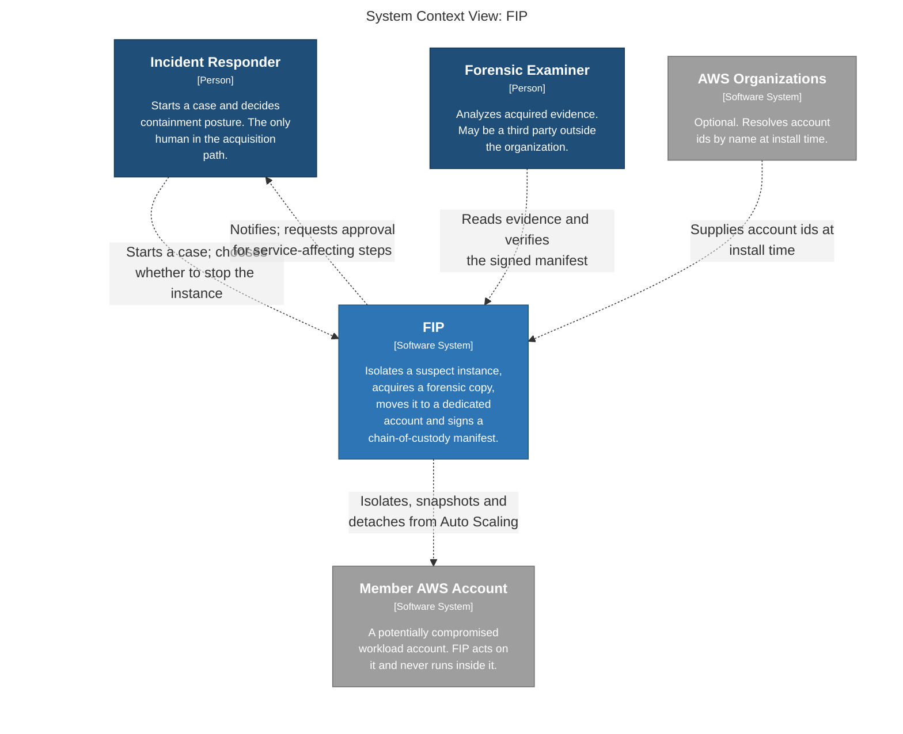

# FIP — architecture (C4)

The model lives in [`fip.dsl`](fip.dsl), written in **Structurizr DSL**. The diagrams
below are generated from it and embedded here so they can be reviewed without running
anything.

**`fip.dsl` is the source of truth.** If a diagram and the DSL disagree, the DSL is
right and this file is stale — regenerate rather than hand-edit.

## Scope

This models what is **built**. Memory capture, detonation and automatic triggering are
designed but not implemented, and are deliberately absent — see
[manual §13](../MANUAL.md#13-what-fip-does-not-do).

One absence in the model is itself a decision: **nothing connects the state machines to
Evidence Release.** Releasing a case's evidence to the analysis account is reachable only
from a human running `fip release`, because the analysis account may belong to a
third party and evidence must not reach an outside party as a side effect of a case being
opened.

## Regenerating

```sh
structurizr-cli validate -w fip.dsl
structurizr-cli export  -w fip.dsl -f mermaid -o /tmp/fipdsl
```

Or browse interactively:

```sh
docker run -it --rm -p 8080:8080 -v "$PWD:/usr/local/structurizr" structurizr/lite
```

---

## Level 1 — System context

FIP runs **outside** the compromised account and never inside it. That is the whole
trust posture: the account under investigation cannot reach the evidence, and cannot
reach the thing doing the investigating.



---

## Level 2 — Containers

Grouped by AWS account, because **the account boundary is the security boundary**:

- **Orchestrator** — runs the case. Holds no evidence and no customer data.
- **Evidence** — holds the forensic key, the Object Lock bucket and the case record.
  Unreachable from the compromised environment.
- **Member** — two roles and an isolation group. Everything FIP puts in a customer
  account, and nothing else.
- **Analysis** — optional, and **may belong to a third-party examiner**, so nothing in
  it can rely on organization membership. Note what is missing from it: an internet
  gateway, a NAT gateway, a route off the VPC, an inbound rule and a key pair. Examiner
  access is an IAM permission, not a host.

Note what is *not* here: FIP has no compute in the member account. It assumes a role
and calls APIs from outside.

There are **two** state machines, and the split is deliberate. `FipCase` is what a
responder starts: it fans out over the targets of one incident and tolerates a target
failing. `FipAcquisition` handles exactly one instance in one account — the right unit of
work, and the wrong unit of operation. Each target gets its own nested execution, so each
target gets its own execution history, which is part of the record.

```mermaid
graph LR
  linkStyle default fill:#ffffff

  subgraph diagram ["Container View: FIP"]
    style diagram fill:#ffffff,stroke:#ffffff

    1["<div style='font-weight: bold'>Incident Responder</div><div style='font-size: 70%; margin-top: 0px'>[Person]</div><div style='font-size: 80%; margin-top:10px'>Starts a case and decides<br />containment posture. The only<br />human in the acquisition<br />path.</div>"]
    style 1 fill:#1f4e79,stroke:#153654,color:#ffffff
    2["<div style='font-weight: bold'>Forensic Examiner</div><div style='font-size: 70%; margin-top: 0px'>[Person]</div><div style='font-size: 80%; margin-top:10px'>Analyzes acquired evidence.<br />May be a third party outside<br />the organization.</div>"]
    style 2 fill:#1f4e79,stroke:#153654,color:#ffffff
    4["<div style='font-weight: bold'>Member AWS Account</div><div style='font-size: 70%; margin-top: 0px'>[Software System]</div><div style='font-size: 80%; margin-top:10px'>A potentially compromised<br />workload account. FIP acts on<br />it and never runs inside it.</div>"]
    style 4 fill:#9e9e9e,stroke:#6e6e6e,color:#ffffff

    subgraph 8 ["FIP"]
      style 8 fill:#ffffff,stroke:#20517f,color:#20517f

      subgraph group1 ["Analysis Account (optional, may be a third party's)"]
        style group1 fill:#ffffff,stroke:#cccccc,color:#cccccc,stroke-dasharray:5

        29["<div style='font-weight: bold'>Isolated VPC</div><div style='font-size: 70%; margin-top: 0px'>[Container: Amazon VPC]</div><div style='font-size: 80%; margin-top:10px'>Private subnets only. No<br />internet gateway, no NAT, NO<br />ROUTE off the VPC - so<br />evidence that executes cannot<br />phone home.</div>"]
        style 29 fill:#5b9bd5,stroke:#3f6c95,color:#ffffff
        30["<div style='font-weight: bold'>VPC Endpoints</div><div style='font-size: 70%; margin-top: 0px'>[Container: VPC Endpoints]</div><div style='font-size: 80%; margin-top:10px'>Interface: ssm, ssmmessages,<br />ec2messages, logs, kms.<br />Gateway: S3, limited to this<br />account's buckets and the AWS<br />package and agent buckets.<br />The only things the<br />workstation can reach.</div>"]
        style 30 fill:#5b9bd5,stroke:#3f6c95,color:#ffffff
        31["<div style='font-weight: bold'>Examiner Workstation</div><div style='font-size: 70%; margin-top: 0px'>[Container: EC2 (Amazon Linux 2023)]</div><div style='font-size: 80%; margin-top:10px'>No public IP, no inbound<br />rules, NO KEY PAIR. Reached<br />only by Session Manager.</div>"]
        style 31 fill:#2e75b6,stroke:#20517f,color:#ffffff
        32("<div style='font-weight: bold'>FipForensicSession</div><div style='font-size: 70%; margin-top: 0px'>[Container: SSM Document]</div><div style='font-size: 80%; margin-top:10px'>Custom Session document<br />carrying the logging config.<br />The account default is never<br />overwritten.</div>")
        style 32 fill:#bf8f00,stroke:#856400,color:#ffffff
        33[("<div style='font-weight: bold'>Session Transcripts</div><div style='font-size: 70%; margin-top: 0px'>[Container: Amazon S3 + CloudWatch Logs]</div><div style='font-size: 80%; margin-top:10px'>Keystroke-level, to S3 and<br />CloudWatch, KMS-encrypted.<br />The examiner cannot delete<br />from it.</div>")]
        style 33 fill:#548235,stroke:#3a5b25,color:#ffffff
        34("<div style='font-weight: bold'>FipExaminerRole</div><div style='font-size: 70%; margin-top: 0px'>[Container: IAM Role]</div><div style='font-size: 80%; margin-top:10px'>Opens a logged session on ONE<br />instance with ONE document.<br />Denied every route to<br />altering the audit trail.</div>")
        style 34 fill:#bf8f00,stroke:#856400,color:#ffffff
        38[("<div style='font-weight: bold'>Tools Bucket</div><div style='font-size: 70%; margin-top: 0px'>[Container: Amazon S3]</div><div style='font-size: 80%; margin-top:10px'>Examiners upload tools from<br />outside the VPC; the<br />workstation can only read.<br />Refuses any write through the<br />VPC. Versioned.</div>")]
        style 38 fill:#548235,stroke:#3a5b25,color:#ffffff
        39[("<div style='font-weight: bold'>Results Bucket</div><div style='font-size: 70%; margin-top: 0px'>[Container: Amazon S3]</div><div style='font-size: 80%; margin-top:10px'>Findings out. Add-only under<br />results/, accepted only<br />through this VPC's S3<br />endpoint. Object Lock<br />enabled, its own KMS key.</div>")]
        style 39 fill:#548235,stroke:#3a5b25,color:#ffffff
        40("<div style='font-weight: bold'>FipResultsReader</div><div style='font-size: 70%; margin-top: 0px'>[Container: IAM Role]</div><div style='font-size: 80%; margin-top:10px'>Reads results from outside<br />the VPC. Denied every write,<br />delete and retention change.</div>")
        style 40 fill:#bf8f00,stroke:#856400,color:#ffffff
      end

      subgraph group2 ["Evidence Account"]
        style group2 fill:#ffffff,stroke:#cccccc,color:#cccccc,stroke-dasharray:5

        23[("<div style='font-weight: bold'>Evidence Bucket</div><div style='font-size: 70%; margin-top: 0px'>[Container: Amazon S3]</div><div style='font-size: 80%; margin-top:10px'>Object Lock ENABLED, no<br />default retention. Signed<br />manifests.</div>")]
        style 23 fill:#548235,stroke:#3a5b25,color:#ffffff
        24[("<div style='font-weight: bold'>Case Table</div><div style='font-size: 70%; margin-top: 0px'>[Container: Amazon DynamoDB]</div><div style='font-size: 80%; margin-top:10px'>Case state and manifest<br />pointer</div>")]
        style 24 fill:#548235,stroke:#3a5b25,color:#ffffff
        25["<div style='font-weight: bold'>Forensic CMK</div><div style='font-size: 70%; margin-top: 0px'>[Container: AWS KMS]</div><div style='font-size: 80%; margin-top:10px'>Evidence is re-encrypted<br />under this key on copy</div>"]
        style 25 fill:#7030a0,stroke:#4e2170,color:#ffffff
        26[("<div style='font-weight: bold'>Retention Policy</div><div style='font-size: 70%; margin-top: 0px'>[Container: AWS SSM Parameter]</div><div style='font-size: 80%; margin-top:10px'>Whether anything is locked,<br />and for how long.<br />Customer-supplied.</div>")]
        style 26 fill:#548235,stroke:#3a5b25,color:#ffffff
        27("<div style='font-weight: bold'>FipEvidenceRole</div><div style='font-size: 70%; margin-top: 0px'>[Container: IAM Role]</div><div style='font-size: 80%; margin-top:10px'>Copies snapshots IN and<br />writes manifests. No delete,<br />no retention change.</div>")
        style 27 fill:#bf8f00,stroke:#856400,color:#ffffff
        28["<div style='font-weight: bold'>Responder Topic</div><div style='font-size: 70%; margin-top: 0px'>[Container: Amazon SNS]</div><div style='font-size: 80%; margin-top:10px'>Case notifications and<br />approval task tokens.<br />Customer subscribes their own<br />handler.</div>"]
        style 28 fill:#548235,stroke:#3a5b25,color:#ffffff
      end

      subgraph group3 ["Member Account (deployed into each)"]
        style group3 fill:#ffffff,stroke:#cccccc,color:#cccccc,stroke-dasharray:5

        35("<div style='font-weight: bold'>FipInventoryRole</div><div style='font-size: 70%; margin-top: 0px'>[Container: IAM Role]</div><div style='font-size: 80%; margin-top:10px'>Read-only. Assumed<br />constantly, changes nothing.</div>")
        style 35 fill:#bf8f00,stroke:#856400,color:#ffffff
        36("<div style='font-weight: bold'>FipResponderRole</div><div style='font-size: 70%; margin-top: 0px'>[Container: IAM Role]</div><div style='font-size: 80%; margin-top:10px'>Mutating. Tag, snapshot,<br />contain, stop. Bounded by a<br />permissions boundary.</div>")
        style 36 fill:#bf8f00,stroke:#856400,color:#ffffff
        37("<div style='font-weight: bold'>Isolation Security Group</div><div style='font-size: 70%; margin-top: 0px'>[Container: EC2 Security Group]</div><div style='font-size: 80%; margin-top:10px'>No ingress, no egress. One<br />per VPC, created on demand.</div>")
        style 37 fill:#bf8f00,stroke:#856400,color:#ffffff
      end

      subgraph group4 ["Orchestrator Account"]
        style group4 fill:#ffffff,stroke:#cccccc,color:#cccccc,stroke-dasharray:5

        10["<div style='font-weight: bold'>FipAcquisition</div><div style='font-size: 70%; margin-top: 0px'>[Container: AWS Step Functions (Standard)]</div><div style='font-size: 80%; margin-top:10px'>One instance in one account.<br />Orders the case and holds the<br />execution history that<br />becomes part of the record</div>"]
        style 10 fill:#1f4e79,stroke:#153654,color:#ffffff
        11["<div style='font-weight: bold'>member-action</div><div style='font-size: 70%; margin-top: 0px'>[Container: AWS Lambda (Node 24)]</div><div style='font-size: 80%; margin-top:10px'>Every call into a member or<br />evidence account. Assumes<br />roles; performs one action<br />per invocation.</div>"]
        style 11 fill:#2e75b6,stroke:#20517f,color:#ffffff
        22["<div style='font-weight: bold'>Manifest Signing Key</div><div style='font-size: 70%; margin-top: 0px'>[Container: AWS KMS]</div><div style='font-size: 80%; margin-top:10px'>ECC_NIST_P384, sign/verify<br />only. Verifiable outside AWS.</div>"]
        style 22 fill:#7030a0,stroke:#4e2170,color:#ffffff
        9["<div style='font-weight: bold'>FipCase</div><div style='font-size: 70%; margin-top: 0px'>[Container: AWS Step Functions (Standard)]</div><div style='font-size: 80%; margin-top:10px'>The execution a responder<br />starts. Fans out over<br />targets; a failed target is<br />recorded, not fatal.</div>"]
        style 9 fill:#1f4e79,stroke:#153654,color:#ffffff
      end

    end

    11-. "<div>Creates and applies</div><div style='font-size: 70%'></div>" .->37
    11-. "<div>CreateSnapshots</div><div style='font-size: 70%'></div>" .->4
    1-. "<div>bin/fip-isolate.sh —<br />pre-flights every target,<br />then StartExecution with the<br />case id and the target list</div><div style='font-size: 70%'></div>" .->9
    9-. "<div>One nested .sync execution<br />per target, 4 at a time.<br />Catches per target.</div><div style='font-size: 70%'></div>" .->10
    9-. "<div>action=caseOpen, caseSummary</div><div style='font-size: 70%'></div>" .->11
    10-. "<div>Invokes once per action;<br />retries transient failures<br />only</div><div style='font-size: 70%'></div>" .->11
    10-. "<div>Publishes case events and<br />task tokens</div><div style='font-size: 70%'></div>" .->28
    28-. "<div>Notifies via the customer's<br />own subscriber</div><div style='font-size: 70%'></div>" .->1
    11-. "<div>sts:AssumeRole with a<br />per-account external ID</div><div style='font-size: 70%'></div>" .->36
    11-. "<div>Assumes for read-only<br />enumeration</div><div style='font-size: 70%'></div>" .->35
    36-. "<div>Tags, snapshots, applies<br />isolation, optionally stops</div><div style='font-size: 70%'></div>" .->4
    36-. "<div>Creates on demand; strips its<br />default egress rule</div><div style='font-size: 70%'></div>" .->37
    37-. "<div>Applied to every network<br />interface</div><div style='font-size: 70%'></div>" .->4
    11-. "<div>sts:AssumeRole. CopySnapshot<br />must run in the destination<br />account.</div><div style='font-size: 70%'></div>" .->27
    27-. "<div>Re-encrypts the copy under<br />the forensic key</div><div style='font-size: 70%'></div>" .->25
    27-. "<div>Writes the signed manifest</div><div style='font-size: 70%'></div>" .->23
    27-. "<div>Records case state</div><div style='font-size: 70%'></div>" .->24
    11-. "<div>kms:Sign over the manifest</div><div style='font-size: 70%'></div>" .->22
    11-. "<div>Reads whether to lock, and<br />for how long</div><div style='font-size: 70%'></div>" .->26
    2-. "<div>Retrieves the manifest and<br />verifies the signature</div><div style='font-size: 70%'></div>" .->23
    1-. "<div>bin/fip-release.sh - a<br />deliberate chain-of-custody<br />decision, never automatic</div><div style='font-size: 70%'></div>" .->11
    11-. "<div>Writes a SIGNED custody<br />record. A revoke never erases<br />a release.</div><div style='font-size: 70%'></div>" .->23
    11-. "<div>Appends a custody entry</div><div style='font-size: 70%'></div>" .->24
    11-. "<div>Grants Decrypt and<br />ReEncryptFrom to the analysis<br />account, or retires the grant</div><div style='font-size: 70%'></div>" .->25
    11-. "<div>Shares the evidence snapshots<br />so volumes can be created<br />from them</div><div style='font-size: 70%'></div>" .->31
    2-. "<div>Assumes. Examiner access is<br />an IAM permission, not a host<br />to log into.</div><div style='font-size: 70%'></div>" .->34
    34-. "<div>ssm:StartSession, pinned to<br />this document AND one<br />instance</div><div style='font-size: 70%'></div>" .->32
    34-. "<div>Opens a logged session. No<br />SSH, no RDP, no key.</div><div style='font-size: 70%'></div>" .->31
    31-. "<div>Dials OUT over HTTPS. Nothing<br />dials in.</div><div style='font-size: 70%'></div>" .->30
    31-. "<div>Runs in a private isolated<br />subnet</div><div style='font-size: 70%'></div>" .->29
    31-. "<div>Appends the transcript.<br />Cannot delete or decrypt it.</div><div style='font-size: 70%'></div>" .->33
    2-. "<div>Uploads tools from outside<br />the VPC</div><div style='font-size: 70%'></div>" .->38
    31-. "<div>Reads tools through the S3<br />endpoint</div><div style='font-size: 70%'></div>" .->38
    31-. "<div>Adds findings through the S3<br />endpoint. No read-back, no<br />delete.</div><div style='font-size: 70%'></div>" .->39
    2-. "<div>Assumes to read findings</div><div style='font-size: 70%'></div>" .->40
    40-. "<div>Reads and lists</div><div style='font-size: 70%'></div>" .->39

  end
```



---

## Level 3 — Components of `member-action`

One Lambda, one action per invocation, driven by the state machine. Two things worth
noticing:

- **The Credential Broker is the only component that crosses an account boundary.**
  Everything else operates on credentials it is handed.
- **Tagging must run first.** Every later permission is scoped by `fip:case-id`, so an
  untagged instance is one FIP cannot act on — that is the containment, not an
  accident of ordering.

```mermaid
graph LR
  linkStyle default fill:#ffffff

  subgraph diagram ["Component View: FIP - member-action"]
    style diagram fill:#ffffff,stroke:#ffffff

    1["<div style='font-weight: bold'>Incident Responder</div><div style='font-size: 70%; margin-top: 0px'>[Person]</div><div style='font-size: 80%; margin-top:10px'>Starts a case and decides<br />containment posture. The only<br />human in the acquisition<br />path.</div>"]
    style 1 fill:#1f4e79,stroke:#153654,color:#ffffff

    4["<div style='font-weight: bold'>Member AWS Account</div><div style='font-size: 70%; margin-top: 0px'>[Software System]</div><div style='font-size: 80%; margin-top:10px'>A potentially compromised<br />workload account. FIP acts on<br />it and never runs inside it.</div>"]
    style 4 fill:#9e9e9e,stroke:#6e6e6e,color:#ffffff

    subgraph 8 ["FIP"]
      style 8 fill:#ffffff,stroke:#20517f,color:#20517f

      subgraph 11 ["member-action"]
        style 11 fill:#ffffff,stroke:#20517f,color:#20517f

        12["<div style='font-weight: bold'>Credential Broker</div><div style='font-size: 70%; margin-top: 0px'>[Component: memberCredentials / evidenceCredentials]</div><div style='font-size: 80%; margin-top:10px'>Two paths: FipResponderRole<br />with an external ID,<br />FipEvidenceRole without.</div>"]
        style 12 fill:#85c1e9,stroke:#5d87a3,color:#000000
        13["<div style='font-weight: bold'>Tagging</div><div style='font-size: 70%; margin-top: 0px'>[Component: tagTarget]</div><div style='font-size: 80%; margin-top:10px'>Tags instance, volumes and<br />interfaces. Must be first -<br />every later permission is<br />scoped by the tag.</div>"]
        style 13 fill:#85c1e9,stroke:#5d87a3,color:#000000
        14["<div style='font-weight: bold'>Containment</div><div style='font-size: 70%; margin-top: 0px'>[Component: containInstance / isolationGroupFor]</div><div style='font-size: 80%; margin-top:10px'>Finds or creates the<br />isolation group, records<br />ORIGINAL security groups,<br />detaches from Auto Scaling.</div>"]
        style 14 fill:#85c1e9,stroke:#5d87a3,color:#000000
        15["<div style='font-weight: bold'>Acquisition</div><div style='font-size: 70%; margin-top: 0px'>[Component: createSnapshots / snapshotStatus]</div><div style='font-size: 80%; margin-top:10px'>Crash-consistent multi-volume<br />snapshot, born tagged.<br />Idempotent by case.</div>"]
        style 15 fill:#85c1e9,stroke:#5d87a3,color:#000000
        16["<div style='font-weight: bold'>Hashing</div><div style='font-size: 70%; margin-top: 0px'>[Component: hashPlan / hashRange / hashCombine]</div><div style='font-size: 80%; margin-top:10px'>Splits a snapshot into<br />bounded ranges and combines<br />range digests into a Merkle<br />root.</div>"]
        style 16 fill:#85c1e9,stroke:#5d87a3,color:#000000
        17["<div style='font-weight: bold'>Evidence Transfer</div><div style='font-size: 70%; margin-top: 0px'>[Component: shareToEvidence / copyToEvidence]</div><div style='font-size: 80%; margin-top:10px'>Grants key access, shares,<br />then copies into the evidence<br />account re-encrypted.</div>"]
        style 17 fill:#85c1e9,stroke:#5d87a3,color:#000000
        18["<div style='font-weight: bold'>Manifest</div><div style='font-size: 70%; margin-top: 0px'>[Component: writeManifest]</div><div style='font-size: 80%; margin-top:10px'>Builds, signs and stores the<br />chain-of-custody record. One<br />manifest per INSTANCE, under<br />the case prefix.</div>"]
        style 18 fill:#85c1e9,stroke:#5d87a3,color:#000000
        19["<div style='font-weight: bold'>Case Record</div><div style='font-size: 70%; margin-top: 0px'>[Component: caseOpen / caseSummary]</div><div style='font-size: 80%; margin-top:10px'>Opens the case row with an<br />empty targets map, then rolls<br />per-target outcomes up to<br />ACQUIRED / PARTIAL / FAILED.</div>"]
        style 19 fill:#85c1e9,stroke:#5d87a3,color:#000000
        20["<div style='font-weight: bold'>Evidence Release</div><div style='font-size: 70%; margin-top: 0px'>[Component: releaseToAnalysis]</div><div style='font-size: 80%; margin-top:10px'>Shares evidence to the<br />analysis account and grants<br />the forensic key, or<br />withdraws both. NOT reachable<br />from the state machines - a<br />human decides, per case.</div>"]
        style 20 fill:#85c1e9,stroke:#5d87a3,color:#000000
        21["<div style='font-weight: bold'>Stop</div><div style='font-size: 70%; margin-top: 0px'>[Component: stopInstance]</div><div style='font-size: 80%; margin-top:10px'>Stops the instance.<br />Service-affecting and loses<br />instance-store data.</div>"]
        style 21 fill:#85c1e9,stroke:#5d87a3,color:#000000
      end

      10["<div style='font-weight: bold'>FipAcquisition</div><div style='font-size: 70%; margin-top: 0px'>[Container: AWS Step Functions (Standard)]</div><div style='font-size: 80%; margin-top:10px'>One instance in one account.<br />Orders the case and holds the<br />execution history that<br />becomes part of the record</div>"]
      style 10 fill:#1f4e79,stroke:#153654,color:#ffffff
      22["<div style='font-weight: bold'>Manifest Signing Key</div><div style='font-size: 70%; margin-top: 0px'>[Container: AWS KMS]</div><div style='font-size: 80%; margin-top:10px'>ECC_NIST_P384, sign/verify<br />only. Verifiable outside AWS.</div>"]
      style 22 fill:#7030a0,stroke:#4e2170,color:#ffffff
      23[("<div style='font-weight: bold'>Evidence Bucket</div><div style='font-size: 70%; margin-top: 0px'>[Container: Amazon S3]</div><div style='font-size: 80%; margin-top:10px'>Object Lock ENABLED, no<br />default retention. Signed<br />manifests.</div>")]
      style 23 fill:#548235,stroke:#3a5b25,color:#ffffff
      24[("<div style='font-weight: bold'>Case Table</div><div style='font-size: 70%; margin-top: 0px'>[Container: Amazon DynamoDB]</div><div style='font-size: 80%; margin-top:10px'>Case state and manifest<br />pointer</div>")]
      style 24 fill:#548235,stroke:#3a5b25,color:#ffffff
      25["<div style='font-weight: bold'>Forensic CMK</div><div style='font-size: 70%; margin-top: 0px'>[Container: AWS KMS]</div><div style='font-size: 80%; margin-top:10px'>Evidence is re-encrypted<br />under this key on copy</div>"]
      style 25 fill:#7030a0,stroke:#4e2170,color:#ffffff
      27("<div style='font-weight: bold'>FipEvidenceRole</div><div style='font-size: 70%; margin-top: 0px'>[Container: IAM Role]</div><div style='font-size: 80%; margin-top:10px'>Copies snapshots IN and<br />writes manifests. No delete,<br />no retention change.</div>")
      style 27 fill:#bf8f00,stroke:#856400,color:#ffffff
      31["<div style='font-weight: bold'>Examiner Workstation</div><div style='font-size: 70%; margin-top: 0px'>[Container: EC2 (Amazon Linux 2023)]</div><div style='font-size: 80%; margin-top:10px'>No public IP, no inbound<br />rules, NO KEY PAIR. Reached<br />only by Session Manager.</div>"]
      style 31 fill:#2e75b6,stroke:#20517f,color:#ffffff
      36("<div style='font-weight: bold'>FipResponderRole</div><div style='font-size: 70%; margin-top: 0px'>[Container: IAM Role]</div><div style='font-size: 80%; margin-top:10px'>Mutating. Tag, snapshot,<br />contain, stop. Bounded by a<br />permissions boundary.</div>")
      style 36 fill:#bf8f00,stroke:#856400,color:#ffffff
      37("<div style='font-weight: bold'>Isolation Security Group</div><div style='font-size: 70%; margin-top: 0px'>[Container: EC2 Security Group]</div><div style='font-size: 80%; margin-top:10px'>No ingress, no egress. One<br />per VPC, created on demand.</div>")
      style 37 fill:#bf8f00,stroke:#856400,color:#ffffff
      9["<div style='font-weight: bold'>FipCase</div><div style='font-size: 70%; margin-top: 0px'>[Container: AWS Step Functions (Standard)]</div><div style='font-size: 80%; margin-top:10px'>The execution a responder<br />starts. Fans out over<br />targets; a failed target is<br />recorded, not fatal.</div>"]
      style 9 fill:#1f4e79,stroke:#153654,color:#ffffff
    end

    12-. "<div>Assumes with external ID</div><div style='font-size: 70%'></div>" .->36
    12-. "<div>Assumes</div><div style='font-size: 70%'></div>" .->27
    14-. "<div>Creates and applies</div><div style='font-size: 70%'></div>" .->37
    15-. "<div>CreateSnapshots</div><div style='font-size: 70%'></div>" .->4
    17-. "<div>Re-encrypts under the<br />forensic key</div><div style='font-size: 70%'></div>" .->25
    18-. "<div>Signs</div><div style='font-size: 70%'></div>" .->22
    18-. "<div>Stores</div><div style='font-size: 70%'></div>" .->23
    18-. "<div>Records, as a nested entry<br />per target - concurrent<br />targets cannot overwrite each<br />other</div><div style='font-size: 70%'></div>" .->24
    19-. "<div>Opens the case row, then<br />writes the roll-up</div><div style='font-size: 70%'></div>" .->24
    19-. "<div>evidence</div><div style='font-size: 70%'></div>" .->12
    1-. "<div>bin/fip-isolate.sh —<br />pre-flights every target,<br />then StartExecution with the<br />case id and the target list</div><div style='font-size: 70%'></div>" .->9
    9-. "<div>One nested .sync execution<br />per target, 4 at a time.<br />Catches per target.</div><div style='font-size: 70%'></div>" .->10
    9-. "<div>action=caseOpen, caseSummary</div><div style='font-size: 70%'></div>" .->19
    36-. "<div>Tags, snapshots, applies<br />isolation, optionally stops</div><div style='font-size: 70%'></div>" .->4
    36-. "<div>Creates on demand; strips its<br />default egress rule</div><div style='font-size: 70%'></div>" .->37
    37-. "<div>Applied to every network<br />interface</div><div style='font-size: 70%'></div>" .->4
    27-. "<div>Re-encrypts the copy under<br />the forensic key</div><div style='font-size: 70%'></div>" .->25
    27-. "<div>Writes the signed manifest</div><div style='font-size: 70%'></div>" .->23
    27-. "<div>Records case state</div><div style='font-size: 70%'></div>" .->24
    1-. "<div>bin/fip-release.sh - a<br />deliberate chain-of-custody<br />decision, never automatic</div><div style='font-size: 70%'></div>" .->20
    20-. "<div>Writes a SIGNED custody<br />record. A revoke never erases<br />a release.</div><div style='font-size: 70%'></div>" .->23
    20-. "<div>Appends a custody entry</div><div style='font-size: 70%'></div>" .->24
    20-. "<div>Grants Decrypt and<br />ReEncryptFrom to the analysis<br />account, or retires the grant</div><div style='font-size: 70%'></div>" .->25
    20-. "<div>Shares the evidence snapshots<br />so volumes can be created<br />from them</div><div style='font-size: 70%'></div>" .->31
    20-. "<div>evidence</div><div style='font-size: 70%'></div>" .->12
    10-. "<div>action=tag</div><div style='font-size: 70%'></div>" .->13
    10-. "<div>action=contain</div><div style='font-size: 70%'></div>" .->14
    10-. "<div>action=stop (only if<br />requested)</div><div style='font-size: 70%'></div>" .->21
    10-. "<div>action=snapshot / status</div><div style='font-size: 70%'></div>" .->15
    10-. "<div>action=hashPlan, hashRange x<br />N, hashCombine</div><div style='font-size: 70%'></div>" .->16
    10-. "<div>action=share, copy,<br />copyStatus</div><div style='font-size: 70%'></div>" .->17
    10-. "<div>action=manifest</div><div style='font-size: 70%'></div>" .->18
    13-. "<div>member</div><div style='font-size: 70%'></div>" .->12
    14-. "<div>member</div><div style='font-size: 70%'></div>" .->12
    15-. "<div>member</div><div style='font-size: 70%'></div>" .->12
    21-. "<div>member</div><div style='font-size: 70%'></div>" .->12
    17-. "<div>member, then evidence</div><div style='font-size: 70%'></div>" .->12
    16-. "<div>member for source, evidence<br />for the retained copy</div><div style='font-size: 70%'></div>" .->12
    18-. "<div>evidence</div><div style='font-size: 70%'></div>" .->12

  end
```


